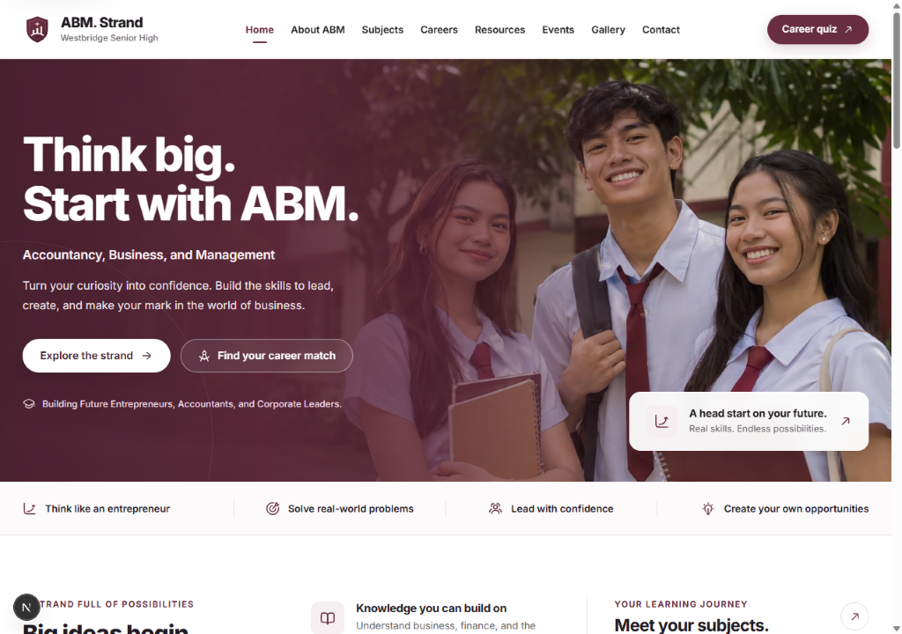
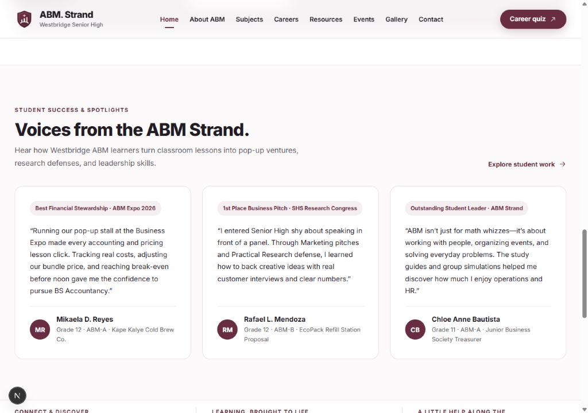
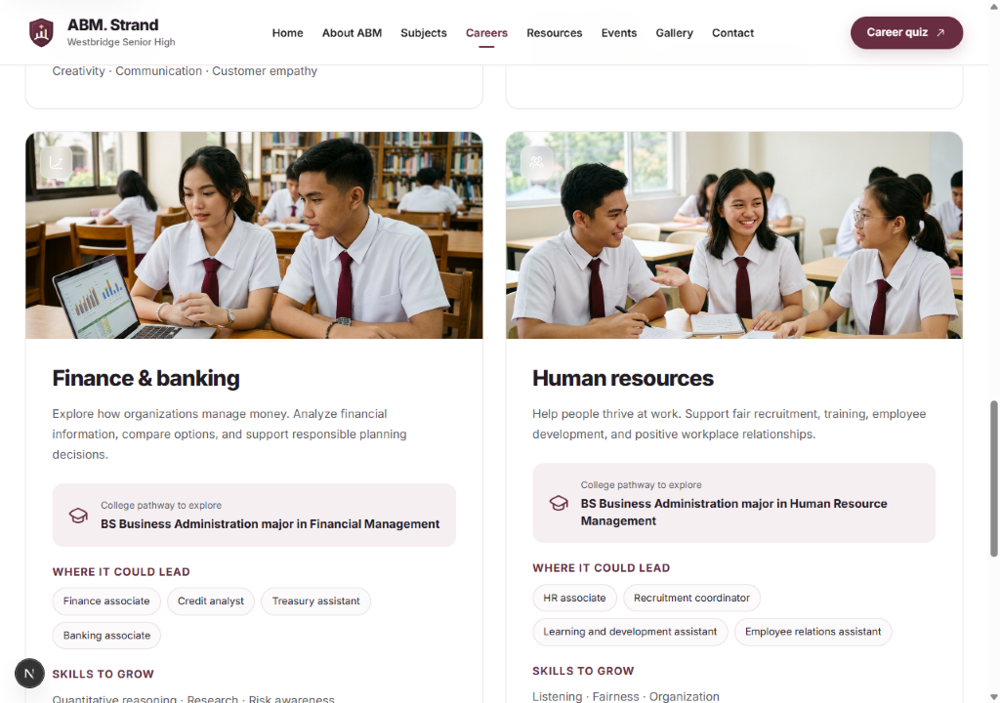
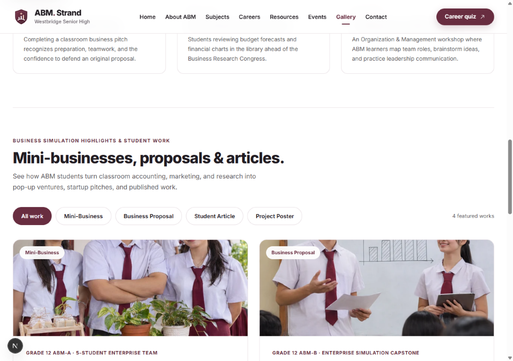
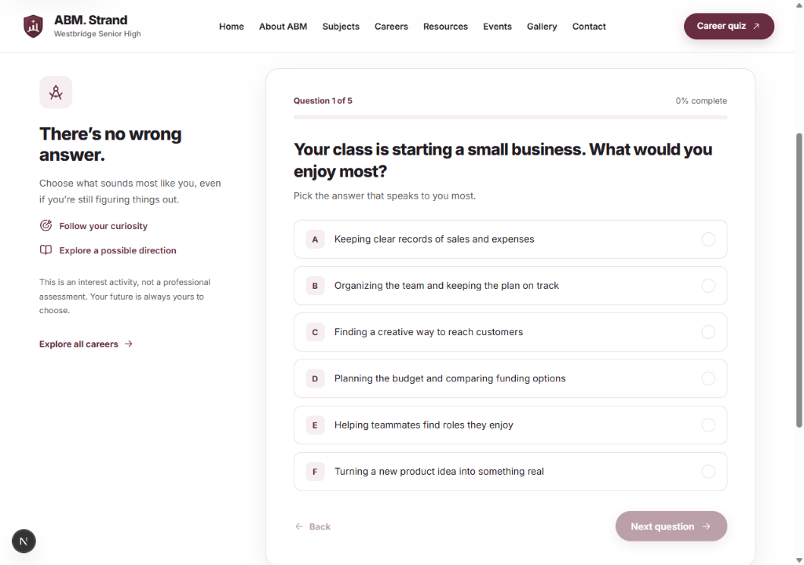
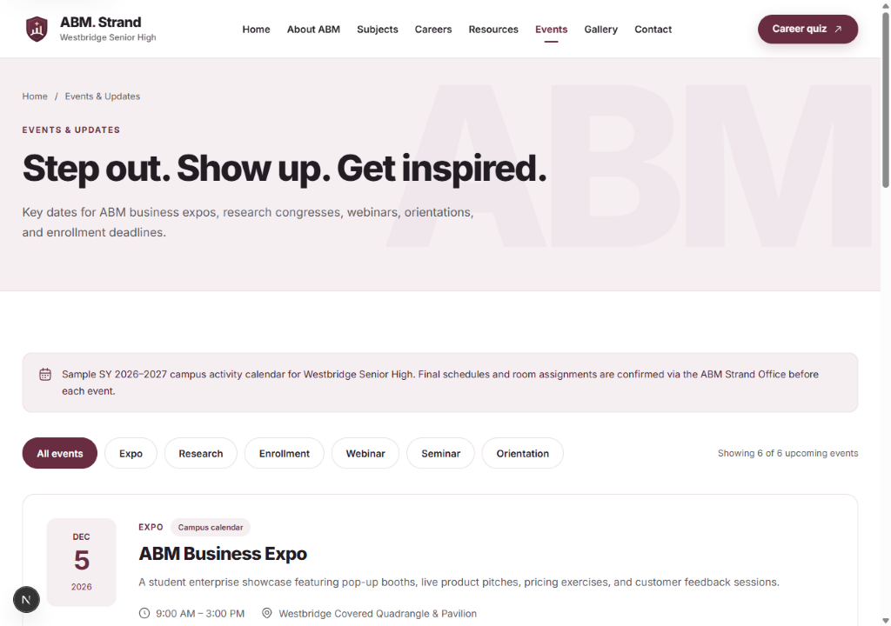
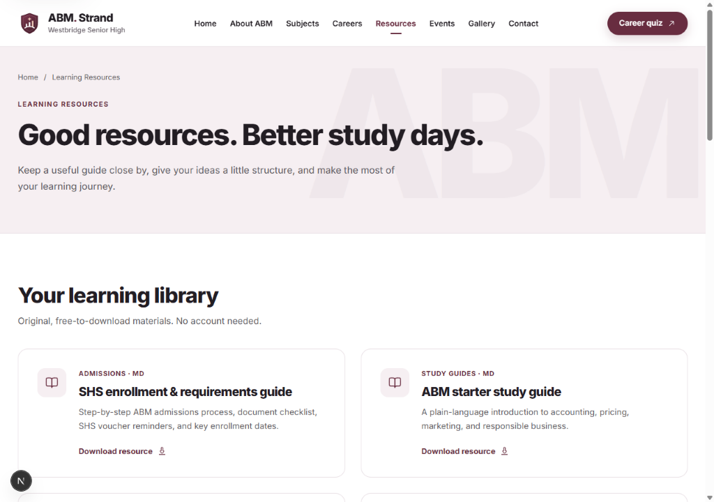
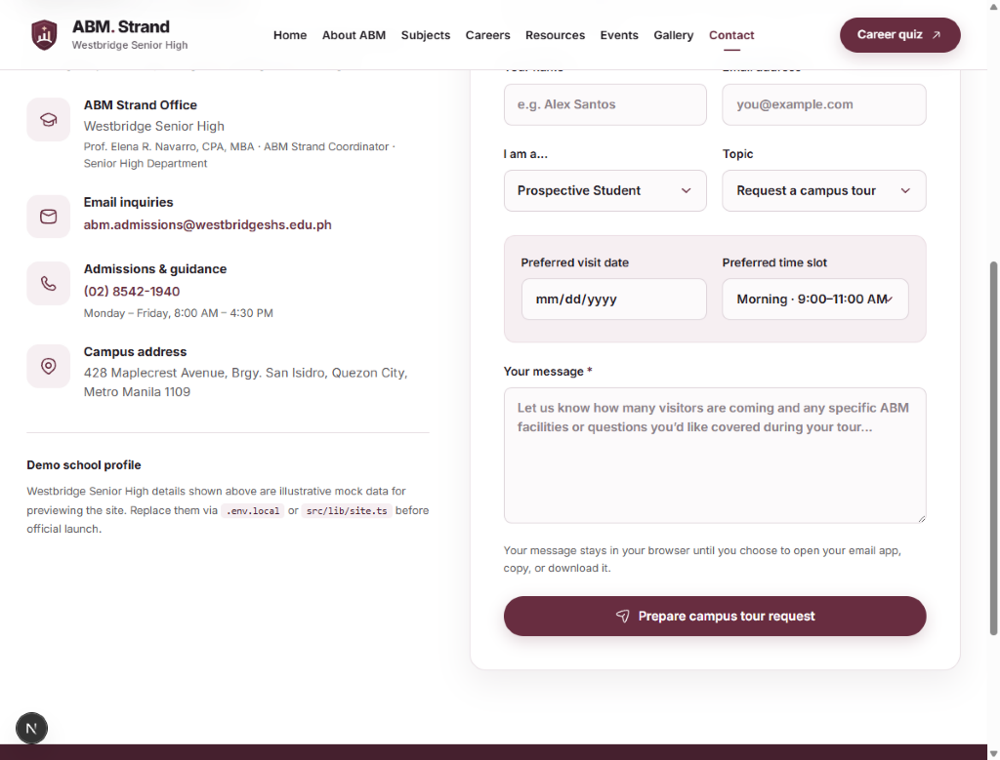

# ABM Strand — Westbridge Senior High Website

> **Building Future Entrepreneurs, Accountants, and Corporate Leaders.**

A complete, responsive, nine-page **Accountancy, Business, and Management (ABM)** Senior High School informational web application built with **Next.js 16 (App Router)**, **React 19**, **strict TypeScript**, **Hugeicons**, **Inter**, and **Lenis smooth scrolling**.

Designed to meet 100% of the **SHS Website Project (ABM Strand)** functional requirements and grading rubric — combining clean academic branding, interactive tools, downloadable study & admissions resources, student business simulation write-ups, and an accessible campus inquiry/tour flow.

---

## Website Preview

### Homepage & Hero


### Student Success & Spotlights


### Career Pathways & Visual Roadmap


### Business Simulation Highlights & Student Work Showcase


### Interactive 5-Question Career Quiz


### Upcoming Events Calendar (Filterable)


### Learning Resources, Enrollment Guide & FAQs


### Contact & Campus Tour Request Form


---

## ABM Project Requirements & Rubric Alignment

| Section | Requirement | Implementation |
| :--- | :--- | :--- |
| **1. Homepage & Overview** | ABM tagline, visual banner, interactive navigation tiles | Full-bleed editorial campus banner, ABM tagline (*"Building Future Entrepreneurs, Accountants, and Corporate Leaders."*), custom SVG school crest logo, 14px navigation bar, pill CTA, and interactive tiles for subjects, careers, quiz, events, gallery, and downloads. |
| **2. ABM Strand Content** | Core & Specialized Subjects | 12 subjects organized across **Specialized (8)**, **Applied (2)**, and **Core (2)** learning areas with topic checklists and anchor jump links. |
| | Business Simulation Highlights | Filterable showcase in `/gallery/#student-work` featuring student mini-businesses (*Kape Kalye Cold Brew Co.*), feasibility proposals (*EcoPack Campus Refill Station*), student articles, and project posters with financial metrics and takeaways. |
| | Career Pathways | 4-step Senior High-to-Career visual roadmap + 6 detailed pathways (**Accountancy**, **Management**, **Marketing**, **Entrepreneurship**, **Finance & Banking**, **Human Resources**) with degree options, job roles, skills, and unique editorial photography. |
| | Student Success & Spotlights | Authentic ABM student quotes and project achievement cards featured on both Home (`/`) and About (`/about/`). |
| **3. Student Resources & Tools** | Downloadable Guides & Templates | 5 free no-account downloads in `public/resources/`: **SHS Enrollment & Requirements Guide**, **ABM Starter Study Guide**, **Subject & Skills Checklist**, **Student Budget Template (CSV)**, and **College Preparation Checklist**. |
| | Interactive Career Quiz | Rule-based 5-question career interest explorer (`/quiz/`) with live progress bar, deterministic tie handling, visual interest breakdown, degree recommendations, and 9 automated unit tests. |
| | Study Tips & FAQs | Practical study habits, official DepEd/BSP/DTI links, and expandable FAQ accordions covering math difficulty, **workload & balancing projects**, curriculum, and college prep. |
| **4. Community & Admissions** | Upcoming Events Calendar | Filterable 6-event campus calendar (`/events/`) covering **Business Expo**, **SHS Research Congress**, **Early Enrollment & Voucher Deadline**, **Young Entrepreneurs Webinar**, **Financial Literacy Seminar**, and **Career Orientation**. |
| | Student Work Showcase & Photo Gallery | 6-photo campus gallery with category filters and accessible native `<dialog>` lightbox (arrow keys, Escape, backdrop close) paired with the Student Work Showcase. |
| | Contact & Campus Tour Form | Inquiry form (`/contact/`) supporting Prospective Students, Parents/Guardians, and Teachers, with conditional **Preferred Visit Date & Time Slot** fields when `"Request a campus tour"` is selected, plus `mailto:` draft, clipboard copy, and `.txt` download. |

---

## Tech Stack

- **Framework**: Next.js 16 (App Router, static export via `output: "export"`)
- **UI & Language**: React 19, TypeScript 5.9 (`strict`)
- **Icons**: Hugeicons (`@hugeicons/react` + `@hugeicons/core-free-icons`)
- **Typography**: Self-hosted Inter (`@fontsource/inter`, weights 400–800)
- **Smooth Scrolling**: Lenis (`lenis`) with `prefers-reduced-motion` support and sticky-header anchor offsets
- **Testing & QA**: Node/TSX unit tests (`src/lib/quiz.test.ts`) + static export link/asset validator (`scripts/check-export.mjs`)

---

## Pages & Routes

| Route | Purpose |
| :--- | :--- |
| `/` | Homepage — Hero, ABM value strip, About preview, Subject tiles, Career cards, Career Quiz callout, Student Spotlights, Events/Gallery/Resources previews |
| `/about/` | About ABM — Strand overview, life skills, student fit checklist, Student Spotlights |
| `/subjects/` | ABM Subjects — Specialized, Applied, and Core subjects with jump navigation & topic breakdowns |
| `/careers/` | Career Pathways — 4-step roadmap + 6 business tracks with degrees, job roles, and skills |
| `/resources/` | Learning Resources — 5 downloadable guides/templates, study habits, DepEd/BSP/DTI links, and FAQ accordions |
| `/events/` | Events & Updates — Filterable 6-event campus calendar with expandable event details |
| `/gallery/` | Student Showcase — Filterable photo gallery with lightbox + Business Simulation & Student Work Showcase |
| `/quiz/` | Interactive Career Quiz — 5-question interest matcher with breakdown bars and college degree suggestions |
| `/contact/` | Get in Touch — Admissions contact details + student/parent inquiry & campus tour request form |

---

## Run Locally

```bash
npm ci
npm run dev
```

Open [http://127.0.0.1:3417](http://127.0.0.1:3417).

### Production Build & Validation

```bash
npm run typecheck
npm test
npm run build
node scripts/check-export.mjs
npm run preview
```

The static production build outputs to `out/` and deploys cleanly to static hosts such as **GitHub Pages**, **Cloudflare Pages**, or **Vercel**.

---

## Customizing School Details

Copy `.env.example` to `.env.local` and override any public school identity fields:

```env
NEXT_PUBLIC_SCHOOL_NAME=Westbridge Senior High
NEXT_PUBLIC_CONTACT_EMAIL=abm.admissions@westbridgeshs.edu.ph
NEXT_PUBLIC_SCHOOL_ADDRESS=428 Maplecrest Avenue, Brgy. San Isidro, Quezon City, Metro Manila 1109
NEXT_PUBLIC_SCHOOL_URL=https://westbridgeshs.edu.ph
```

Key content files:
- `src/lib/site.ts` — School identity, contact profile, and top navigation
- `src/lib/content.ts` — Subjects, careers, student spotlights, student work showcase, gallery, events, downloadable resources, and FAQs
- `src/lib/quiz.ts` — Career quiz questions and scoring engine
- `src/components/school-logo.tsx` — Custom SVG collegiate crest logo
- `src/app/globals.css` — Design tokens, spacing scale, and responsive breakpoints

---

*Note: Westbridge Senior High and its sample dates, contact details, student spotlights, and AI-generated editorial campus imagery (`public/image-prompts.md`) are illustrative demo content created for this Senior High School ABM website project.*
